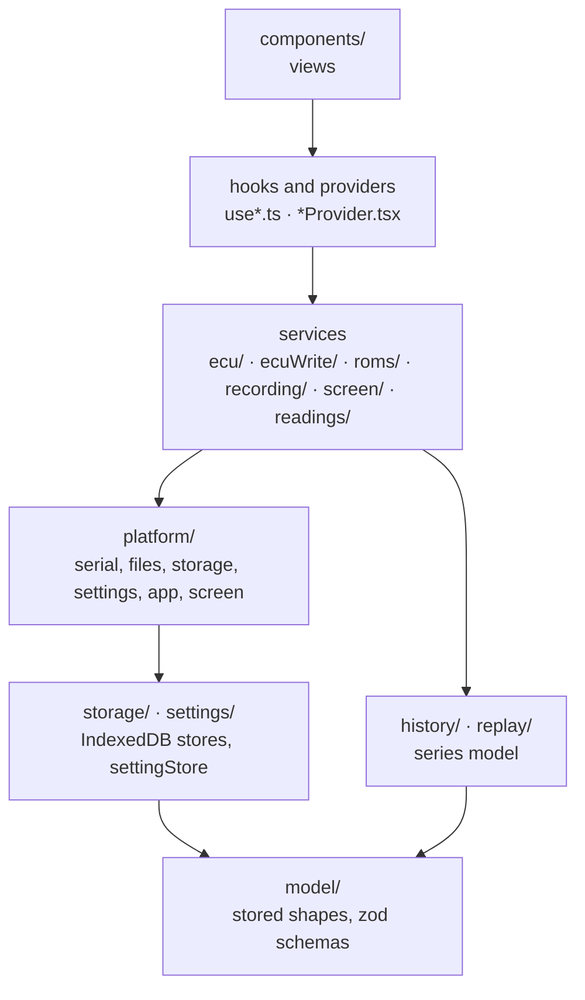
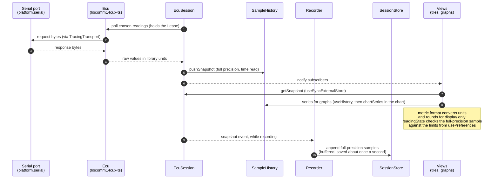

# Architecture

How 14CUX Gauge is put together after the #76–#81 refactors. The rules behind
it are in [AGENTS.md](../AGENTS.md#state-and-data).

Keep this document up to date: a pull request that changes a service, hook,
provider, store, platform part, layer, stored shape or the flow of readings
updates the plain-language guide and the diagrams too.

## In plain words

This part explains the app without code. The diagrams after it show the same
ideas in more detail.

### What the app does

The app talks to a 14CUX engine computer, called the ECU. It asks the ECU for
readings, such as engine speed and coolant temperature, over and over. It shows
the readings, draws them on graphs, and can save them so you can look at them
later.

### The layers

Think of the app as a stack of layers. Each layer may use the layers below it,
but never the ones above it. From top to bottom:

1. **Views** are the screens, tiles, graphs and buttons you see. They show
   data, but they never fetch it themselves. The dashboard, the dash and the
   sessions views are downloaded just after the app starts, so the first screen shows
   sooner. If one of them breaks, only that view shows an error and a Reload
   button. Going to another page tries the view again. The app bar and
   status bar keep working, so you can still disconnect.
2. **Hooks and providers** are the go-betweens. A view asks a hook for what it
   needs, and the hook gets it from a service.
3. **Services** do the real work. There are seven:
   - **EcuSession** connects to the ECU, asks it for readings again and again,
     and keeps the recent ones.
   - **EcuWrites** sends commands that change something in the ECU, such as
     clearing fault codes or running the fuel pump. The app always asks you to
     confirm first.
   - **Recorder** saves readings into a session while you record. When a
     recording starts, it first asks EcuSession to read which ECU it is:
     the tune, rev limit, fuel map and stored fault codes. The tune is in
     the ROM and cannot change, so a recording uses the last time it was
     read on this connection. The recording's start time is taken after
     these reads, and any write made during them is still saved with it.
   - **RomReader** copies the ECU's program, called the ROM image, so you can
     keep it.
   - **ScreenWake** keeps the screen from going to sleep while an ECU is
     connected, if you chose that in Preferences. It lets go as soon as you
     disconnect, and the status bar says when the screen is kept on or when
     the browser would not do it.
   - **StorageService** opens the place where sessions and ROM images are kept.
   - **AppStatusStore** knows whether you are offline and whether a newer
     version of the app is out.
4. **Platform** is the only part that talks to the browser directly: the
   serial port (including the ports you already allowed, which the connect
   screen offers to reconnect to), saving files, storage, settings, the screen
   (keeping it on, and full screen) and reloading the page. A
   desktop version could swap in its own platform without changing the rest.
5. **Storage and settings** keep things between visits.
6. **Model** is the bottom layer. It sets the rules for what each kind of data
   looks like.

Only one part of the app may talk to the ECU at a time. EcuSession hands out a
**lease**, which works like a key. Whoever holds the key may talk to the ECU.
Everyone else waits. EcuWrites and RomReader borrow the key when they need it.

### A reading's trip

1. EcuSession asks the ECU for readings. The ECU answers with bytes over the
   serial cable.
2. The ECU library (libcomm14cux-ts) turns those bytes into values, such as rpm,
   °F or volts. The app keeps these values exactly as they arrive. It does not
   round them or change their units.
3. One pass over the readings, plus the time it was taken, is a
   **snapshot**.
4. The snapshot goes into the **history**, which holds the last 100,000
   snapshots. When it is full, the oldest one is dropped.
5. Tiles show the newest snapshot. Graphs draw from the history.
6. Values are rounded and changed to your units (such as °C) only at the moment
   they are shown. The kept value never changes.
7. If you are recording, the Recorder collects snapshots and saves them about
   once a second.

A reading can also have **limits**: up to four levels (very low, low, high,
very high) that you set in Preferences. The app suggests a starting point for
some readings, such as coolant and voltage, and you can change or clear any
of them. Limits are kept in the ECU library's units, like readings. A live
reading is checked against them at full precision, never after rounding.
When it reaches one, its tile says so in words ("hot", "low") and in colour,
a dial shows the levels as coloured bands, and a live graph draws them as
dashed lines and lists them. Recordings do not keep limits, so replay shows
none. If you type a level the app cannot use, it says why beside the box.
If you then try to close Preferences, it stays open once to show you, so a
mistake is never thrown away without you seeing it.

Some readings change slowly, such as coolant temperature and battery voltage.
The app reads those less often, usually on every tenth pass. In the passes
between, a snapshot repeats the last value it read.

### What a snapshot holds

Each reading in a snapshot is one of three things, and the app never mixes them
up:

- **A value**: a number, or on and off.
- **Missing**: the app did not ask for it, because you turned that reading
  off.
- **Invalid**: the ECU sent back a value that cannot be right.

None of these is the same as zero. On a graph, an invalid reading is a gap, not
a drop to zero.

### What gets saved

These are kept in the browser's database:

- **Sessions.** Each one has a name, notes, start and end times, the number of
  samples, and whether it came from a real ECU or the demo. It also keeps
  which ECU it came from: the tune number, ident, checksum fixer, rev limit,
  fuel map and the fault codes that were set, each with the time it was
  read. The tune is the last one read on the connection; the rest are read
  when recording starts. A value that could not be read says
  why. Sessions saved before this was kept say "Not recorded". Its snapshots
  are saved beside it in batches.
- **Writes.** Each command sent to the ECU during a recording, with when it
  started and ended and how it went: done, failed, or only partly done.
- **Where it came from.** A session opened from a recording file notes the
  file's name, when it was opened, and when and by what the file was saved.
- **ROM images.** The copied program, with its tune number, size, a
  fingerprint (SHA-256) to tell copies apart, and whether it came from a real
  ECU or the demo.

**Settings**, such as units, theme, reading limits and which readings to show
(one list for the overview, graphs and recordings, and another for the Dash
view), are small. They
are kept apart from the database, in the browser's local storage. Every
setting has a default, and so does each part of one. A new version can add a
setting without breaking an older one: the older version uses its default for
anything it does not know, and keeps the new part when it saves.

Each saved item carries a **format version**. When the shape of an item
changes, its version number goes up. Older items are updated as they are read;
they are never rewritten where they sit. Every item is checked against its
shape when it is read. If the app cannot read one, it lists it so you can
delete it, instead of hiding it.

### Recording files

You can save sessions as a file and open them again, here or on another
computer. The file is JSON, and its shape is written down in
[recording-file.md](recording-file.md), because other people and tools may
rely on it. It keeps everything a session has, with every sample exactly as it
was recorded. When the app opens a file, it checks all of it first. If any part
is wrong, or the file is from a newer version, it says why and opens nothing.

### Replay

When you open a saved session, the app builds a history from its snapshots,
just as it does with live readings. The graphs then work the same way for both,
so a gap or a high point reads the same live and in replay.

## Structure

`main.tsx` builds the `Platform` and the `AppServices` once and hands them to
`<App>`. React providers only expose the services; views reach them through
hooks. `App.tsx` loads `Dashboard`, `DashView` and `SessionsView` with React's `lazy`,
each inside its own `ViewBoundary` (an error boundary and a `Suspense`
boundary). Arrows point from the user of a module to the module it uses.

```mermaid
flowchart TB
  main["main.tsx<br/>createAppServices(browserPlatform())"]

  subgraph views["components/ — views"]
    direction LR
    Connect[ConnectScreen]
    Dash["Dashboard (lazy)<br/>LiveTiles · GraphsView · FuelMapView<br/>FaultCodes · EcuInfo · tests"]
    DashV["DashView (lazy)<br/>large readings, stale marking"]
    Sessions["SessionsView (lazy)<br/>SessionList · SessionTable<br/>SessionDetail · SessionReplay"]
    Chrome["StatusBar · Preferences · Footer<br/>SaveSessionDialog · AppNotices"]
  end

  subgraph react["Hooks and providers — React"]
    direction LR
    HEcu["useEcu · useEcuRead<br/>useLiveData · useHistory<br/>useLiveStatus"]
    HWrite["useEcuWrite<br/>useFuelPumpRun"]
    HRec[useRecording]
    HRoms[useRoms]
    HSess["useSessions · useSessionList<br/>useSessionSamples"]
    HSet["useSetting · usePreferences<br/>ReadingsProvider"]
    HReplay["useReplay<br/>useRecordedSeries"]
    HRoute["routing/<br/>React Router · usePreferencesRoute"]
    HAppStatus[useAppStatus]
    HScreen["useScreenWake<br/>useFullscreen"]
    HPlat[usePlatform]
  end

  subgraph services["AppServices — plain TS, subscribe / getSnapshot"]
    direction LR
    Session["EcuSession<br/>ecu/"]
    Writes["EcuWrites<br/>ecuWrite/"]
    Recorder["Recorder<br/>recording/"]
    Roms["RomReader<br/>roms/"]
    Wake["ScreenWake<br/>screen/"]
    StorageSvc["StorageService<br/>storage/"]
    AppStatus["AppStatusStore<br/>pwa/"]
  end

  subgraph series["Series model — history/ · replay/"]
    direction LR
    SampleHistory["SampleHistory<br/>pushSnapshot"]
    ChartSeries["chartSeries<br/>timeline"]
  end

  subgraph platform["platform/ — the only reader of browser globals"]
    direction LR
    Serial["serial<br/>WebSerialTransport"]
    Files["files<br/>save · open"]
    StorePlat["storage<br/>open"]
    SettingsBE["settings<br/>localStorage"]
    AppPlat["app<br/>reload"]
    ScreenPlat["screen<br/>wakeLock · fullscreen"]
  end

  subgraph persist["storage/ · settings/"]
    direction LR
    Stores["SessionStore · RomStore<br/>IndexedDB or memory"]
    SettingStore["settingStore<br/>zod-checked"]
  end

  Model["model/ · metrics.ts · units.ts<br/>zod schemas, snapshots, formatting"]
  Lib[("libcomm14cux-ts<br/>Ecu · Transport")]
  Demo["demo/<br/>DemoEngine"]
  Diag["diagnostics/<br/>TracingTransport · DiagnosticLog"]

  main --> services
  main --> platform

  Connect & Dash & DashV & Chrome --> HEcu
  Dash --> HWrite
  Dash & DashV & Sessions & Chrome --> HRec
  Dash --> HRoms
  Sessions & Chrome --> HSess
  Sessions --> HReplay
  views --> HSet
  views --> HRoute
  Chrome --> HAppStatus
  Dash & DashV & Chrome --> HScreen
  Connect & Sessions & Chrome --> HPlat
  Dash & Sessions --> ChartSeries

  HEcu --> Session
  HWrite --> Writes
  HRec --> Recorder
  HRoms --> Roms
  HSess --> StorageSvc
  HSet --> SettingStore
  HSet -. chosen readings, or the dash's alone .-> Session
  HReplay --> SampleHistory
  HEcu --> SampleHistory
  HAppStatus --> AppStatus
  HPlat --> Serial
  HPlat --> Files
  HPlat --> AppPlat
  HScreen --> Wake
  HScreen --> ScreenPlat
  HSet -. keep the screen on .-> Wake

  Writes --> Session
  Recorder --> Session
  Recorder --> Writes
  Recorder --> StorageSvc
  Roms --> Session
  Roms --> StorageSvc
  Roms --> Recorder
  Roms --> Files
  Wake --> Session
  Wake --> ScreenPlat

  Session --> SampleHistory
  SampleHistory --> ChartSeries
  Session -- "Lease · Ecu calls" --> Lib
  Writes -- "Lease · Ecu calls" --> Lib
  Roms -- "Lease · Ecu calls" --> Lib
  Session --> Serial
  Session --> Demo
  Session --> Diag
  Diag --> Lib
  Serial --> Lib

  StorageSvc --> StorePlat
  StorePlat --> Stores
  SettingStore --> SettingsBE

  series --> Model
  persist --> Model
  services --> Model
```

### Layers

A module never imports from a layer above its own; `eslint.config.js` enforces
the boundaries. As above, arrows point from a layer to the layers it may use.
`history/` and `replay/` (outside their hooks) use only `model/`, `metrics` and
`units`, so the series model sits below the services and views that read it.

## Live data flow

One polling pass, from the serial port to a tile, a graph and a recording.

As a recording starts, the `Recorder` asks `EcuSession.readNow` to run
`readIdentity` (in `ecu/reads.ts`) beside polling, and stores the result in
the session's summary (since format 4). `readNow` reads nothing while a ROM read
has the link to itself, and the identity then says it was not read. A holder
that takes the link while a `readNow` read is running waits for it before
polling pauses. The tune revision is in the ROM, so `reads.ts` keeps the last
read of it for each connection's `Ecu`, with the time it was read. Every
recording on that connection uses it; the ECU info reads it afresh when
asked, which replaces it. A failed read never replaces a good one. The rev
limit, fuel map and fault codes are in the ECU's RAM and are read as each
recording starts. While this happens `RecorderState.starting` is set, the
`Recorder` already watches `EcuWrites`, and the session's `startedAt` is
taken once the reads are done.

ECU writes (clearing faults, actuator tests) go the other way: a view behind
`ConfirmDialog` calls `useEcuWrite`, which asks `EcuWrites`; `EcuWrites` takes
the `Lease` from `EcuSession`, calls the `Ecu` through it, keys the outcome by
`EcuLink`, and the `Recorder` logs it into the current session. `RomReader`
reads the ROM image the same way, through a `Lease` of its own.

When a connection fails, `EcuSession` works out how far it got from what it
saw: whether the port opened, whether any bytes came back (`CountingTransport`
counts them under the `Ecu`), and whether the ECU gave a valid reply. That
`FailureStage` goes in the connection's `error` state with the message, so
polling retries change nothing on screen and the failure is announced once.
`connectionHelp` holds the words for each stage, and `FailureDialog` lists what
to check, with an offer to try the other baud rate when no valid reply came
back. `EcuSession.onAnswered` tells `StatusBar` when the ECU first answers, and
only then is that rate saved. Demo mode has no serial line, so it has no stage.
A browser with no Web Serial never connects, so `ConnectScreen`
says why, using the platform's `serial.available()` and `serial.securePage()`.
If the browser blocks the port picker, `ConnectScreen` lists the same checks as
the failure dialog, through `ConnectionChecks`.

Preferences is a dialog over whichever view is showing, opened by the gear
in the app bar. Which section is open is a query on the view's address
(`#/live?preferences=limits`, see `routing/paths.ts`), read and changed by
`usePreferencesRoute`: opening pushes a history entry, changing section
replaces it, and closing goes back to the entry before, so Back closes the
dialog. Opened from a link, closing removes the query instead. Every choice
in it applies at once through `PreferencesProvider`.

Limits live in the `limits` setting (`settings/limitSettings.ts`), which
stores only the readings whose limits differ from their suggestion
(`Metric.limits.suggested` in `metrics.ts`), in library units.
`PreferencesProvider` exposes them as `ownLimits`, and `limitsFor` picks the
user's or the suggestion; `setReadingLimits` changes one reading's from the
stored value, so a change made in another window is kept. One zod schema,
`limitsSchema` in `model/limits.ts`, checks a reading's levels are finite and
in order, both when the setting is read (a reading out of order falls back to
its suggestion) and when the user types them: `limitFormSchema`
(`settings/limitForm.ts`) turns the typed text into library units and pipes
it into `limitsSchema`, and each reading in `LimitsPreferences` is a
react-hook-form form checked by that schema through `zodResolver`.
`Preferences` holds a `PendingEdits` (`components/pendingEdits.ts`) so that
closing it or changing section applies what was typed first, or stays open
once to show why it cannot. `readingState` turns a sample and its limits into a
tone and a note for `LiveTiles` and `DashView`; `dialBands` and
`limitLinesPlugin` draw the same levels on dials and live graphs. Replay passes
no limits.

`SessionsProvider` saves and opens recording files through
`sessions/recordingFiles.ts`: saving reads each chosen session from the
`SessionStore`, and opening checks the whole file against the `zod/mini`
schema in `model/recordingFile.ts` before `SessionStore.importSessions` stores
every recording in one transaction, each under a new id and in session format
5 with an `imported` note. The views ask `platform.files` to save the text or
to let the user choose a file to open. `SessionTable` uses TanStack Table
(`sessions/sessionTable.ts` defines its columns) for sorting and for choosing
sessions to save together; the chosen ids are React state in `SessionList`.

Replay reads a stored session through `useSessionSamples`, and
`useRecordedSeries` builds a `SampleHistory` from it with `pushSnapshot`, as
`EcuSession` does live. The charts draw both with `chartSeries`, and `useReplay`
drives the shared timeline, so a gap or an extreme reads the same live and in
replay.
