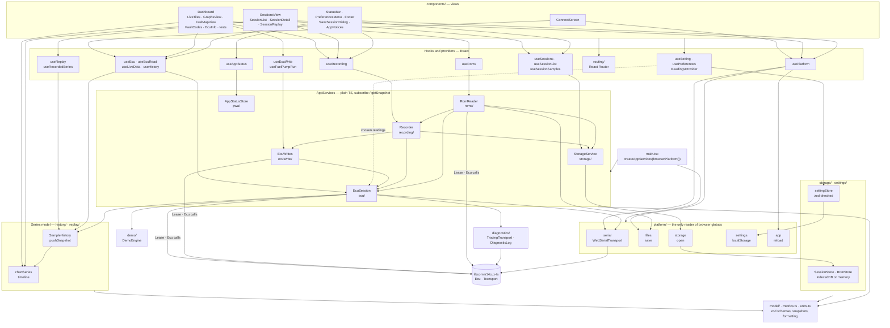
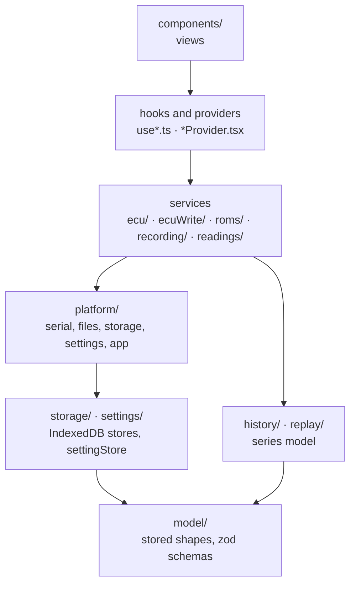
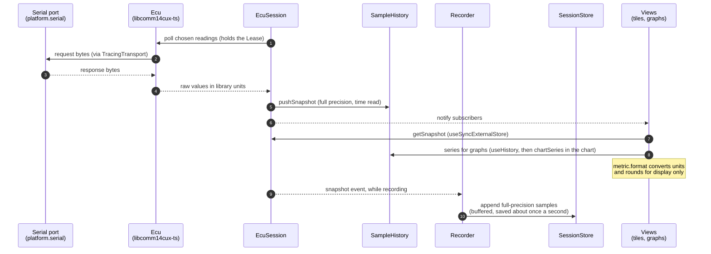

# Architecture

How 14CUX Gauge is put together after the #76–#81 refactors. The rules behind
it are in [AGENTS.md](../AGENTS.md#state-and-data).

Keep this document up to date: a pull request that changes a service, hook,
provider, store, platform part, layer, stored shape or the flow of readings
updates the plain-language guide and the diagrams too.

## In plain words

This part explains the app without code. The diagrams after it show the same
ideas in more detail.

### What the app does

The app talks to a 14CUX engine computer, called the ECU. It asks the ECU for
readings, such as engine speed and coolant temperature, over and over. It shows
the readings, draws them on graphs, and can save them so you can look at them
later.

### The layers

Think of the app as a stack of layers. Each layer may use the layers below it,
but never the ones above it. From top to bottom:

1. **Views** are the screens, tiles, graphs and buttons you see. They show
   data, but they never fetch it themselves.
2. **Hooks and providers** are the go-betweens. A view asks a hook for what it
   needs, and the hook gets it from a service.
3. **Services** do the real work. There are six:
   - **EcuSession** connects to the ECU, asks it for readings again and again,
     and keeps the recent ones.
   - **EcuWrites** sends commands that change something in the ECU, such as
     clearing fault codes or running the fuel pump. The app always asks you to
     confirm first.
   - **Recorder** saves readings into a session while you record.
   - **RomReader** copies the ECU's program, called the ROM image, so you can
     keep it.
   - **StorageService** opens the place where sessions and ROM images are kept.
   - **AppStatusStore** knows whether you are offline and whether a newer
     version of the app is out.
4. **Platform** is the only part that talks to the browser directly: the
   serial port, saving files, storage, settings and reloading the page. A
   desktop version could swap in its own platform without changing the rest.
5. **Storage and settings** keep things between visits.
6. **Model** is the bottom layer. It sets the rules for what each kind of data
   looks like.

Only one part of the app may talk to the ECU at a time. EcuSession hands out a
**lease**, which works like a key. Whoever holds the key may talk to the ECU.
Everyone else waits. EcuWrites and RomReader borrow the key when they need it.

### A reading's trip

1. EcuSession asks the ECU for readings. The ECU answers with bytes over the
   serial cable.
2. The ECU library (libcomm14cux-ts) turns those bytes into values, such as rpm,
   °F or volts. The app keeps these values exactly as they arrive. It does not
   round them or change their units.
3. One pass over the readings, plus the time it was taken, is a
   **snapshot**.
4. The snapshot goes into the **history**, which holds the last 100,000
   snapshots. When it is full, the oldest one is dropped.
5. Tiles show the newest snapshot. Graphs draw from the history.
6. Values are rounded and changed to your units (such as °C) only at the moment
   they are shown. The kept value never changes.
7. If you are recording, the Recorder collects snapshots and saves them about
   once a second.

Some readings change slowly, such as coolant temperature and battery voltage.
The app reads those less often, usually on every tenth pass. In the passes
between, a snapshot repeats the last value it read.

### What a snapshot holds

Each reading in a snapshot is one of three things, and the app never mixes them
up:

- **A value**: a number, or on and off.
- **Missing**: the app did not ask for it, because you turned that reading
  off.
- **Invalid**: the ECU sent back a value that cannot be right.

None of these is the same as zero. On a graph, an invalid reading is a gap, not
a drop to zero.

### What gets saved

These are kept in the browser's database:

- **Sessions.** Each one has a name, notes, start and end times, the number of
  samples, and whether it came from a real ECU or the demo. Its snapshots are
  saved beside it in batches.
- **Writes.** Each command sent to the ECU during a recording, with when it
  started and ended and how it went: done, failed, or only partly done.
- **ROM images.** The copied program, with its tune number, size, a
  fingerprint (SHA-256) to tell copies apart, and whether it came from a real
  ECU or the demo.

**Settings**, such as units, theme and which readings to show, are small. They
are kept apart from the database, in the browser's local storage.

Each saved item carries a **format version**. When the shape of an item
changes, its version number goes up. Older items are updated as they are read;
they are never rewritten where they sit. Every item is checked against its
shape when it is read. If the app cannot read one, it lists it so you can
delete it, instead of hiding it.

### Replay

When you open a saved session, the app builds a history from its snapshots,
just as it does with live readings. The graphs then work the same way for both,
so a gap or a high point reads the same live and in replay.

## Structure

`main.tsx` builds the `Platform` and the `AppServices` once and hands them to
`<App>`. React providers only expose the services; views reach them through
hooks. Arrows point from the user of a module to the module it uses.

### Layers

A module never imports from a layer above its own; `eslint.config.js` enforces
the boundaries. As above, arrows point from a layer to the layers it may use.
`history/` and `replay/` (outside their hooks) use only `model/`, `metrics` and
`units`, so the series model sits below the services and views that read it.

## Live data flow

One polling pass, from the serial port to a tile, a graph and a recording.

ECU writes (clearing faults, actuator tests) go the other way: a view behind
`ConfirmDialog` calls `useEcuWrite`, which asks `EcuWrites`; `EcuWrites` takes
the `Lease` from `EcuSession`, calls the `Ecu` through it, keys the outcome by
`EcuLink`, and the `Recorder` logs it into the current session. `RomReader`
reads the ROM image the same way, through a `Lease` of its own.

Replay reads a stored session through `useSessionSamples`, and
`useRecordedSeries` builds a `SampleHistory` from it with `pushSnapshot`, as
`EcuSession` does live. The charts draw both with `chartSeries`, and `useReplay`
drives the shared timeline, so a gap or an extreme reads the same live and in
replay.
